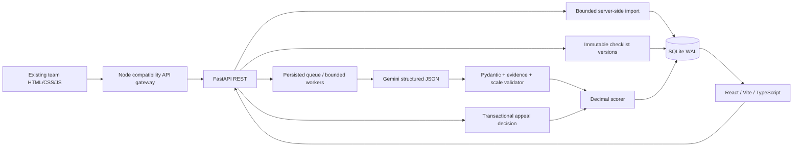

# Architecture

`backend/app/db.py` defines schema version 1 with foreign keys, uniqueness constraints and append-only checklist/AI judgment/review decision triggers. `evaluation_runs` stores each original transcript snapshot, model identity, original and finalized results, raw response (local DB only), measured usage and errors. Criteria are JSON in immutable versions and normalized original judgment rows. Batch items are evaluation runs with a `batch_id`, rather than a duplicate item table. An import transaction rejects changed records atomically, preserving stable evidence IDs; import updated source records under a different group.

Workers claim a queued run within `BEGIN IMMEDIATE`. The configurable worker count limits concurrency across single and batch requests in one process. On restart, queued runs resume; interrupted processing runs become failed with a visible retry message. Retries make a new run/batch, preserving failed attempts. Run only one Uvicorn process against this prototype database; there is no distributed coordinator. Use a durable queue and production database for horizontal scaling.

Checklist configuration and the original language transcript drive a single structured LLM call per attempt. There are no C01–C08 evaluation branches; new criterion IDs work through configuration. At most three attempts per evaluation, with bounded backoff. SDK automatic retries are disabled so attempts and measured tokens can be tracked. HTTP 4xx other than 408/429 are not retried. Invalid JSON/schema/evidence never receives a score.

The provider is an interface. Gemini is the live implementation. The deterministic fake is in `backend/tests/` and is injected only when `Settings.testing=True`; normal routes have no fake-mode switch. `scripts/e2e_server.py` is an explicitly gated automated-test harness on a separate port/database.

The frontend has separate pages, API/types modules and reusable transcript/evidence/report components. A future Dynamics 365 HTML web resource can reuse these HTML/CSS/JS components, set an API base URL, and replace the shell and demo identity with the host's authenticated context. Production authentication, authorization, secrets, allowed origins and transport need an integration design first.

The team gateway is `server.js` with a translation boundary in `lib/backend-client.js`. It serves public assets and delegates all persisted operations to FastAPI. It does not import the old JSON store or keyword evaluation engine. The legacy checklist weight sandbox remains a UI preview only. The gateway can target a separately running backend via `CQA_BACKEND_URL`; the default cross-platform `npm start` launcher starts and owns a local backend if necessary.
